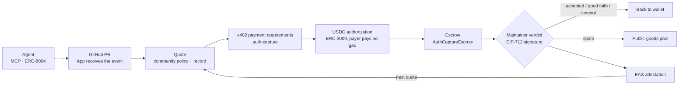

<p align="center"></p>

<p align="center"><b>English</b> · <a href="README.zh-CN.md">简体中文</a></p>

<p align="center">
  
  <a href="https://sepolia.basescan.org/address/0x13a61b1af8041e8c8783217bcb2b8bfba2c767aa"></a>
  <a href="https://github.com/coinbase/x402"></a>
  <a href="https://github.com/base/commerce-payments"></a>
  <a href="https://attest.org"></a>
  <a href="https://eips.ethereum.org/EIPS/eip-8004"></a>
  <a href="https://modelcontextprotocol.io"></a>
  
</p>

<p align="center"><b>An admission protocol for open communities.</b><br>Strangers come in with a refundable bond and earn trust by contributing.</p>

<p align="center">
  <a href="https://xenia-silk.vercel.app">Website</a> ·
  <a href="https://xenia-silk.vercel.app/xenia-deck.pdf">Deck (PDF)</a> ·
  <a href="https://base-sepolia.easscan.org/attestation/view/0x45243f5cff5458d25de9c67e0aed089db86e8335ac0abc2279b39db4ad90d254">On-chain proof</a> ·
  <a href="#run-it">Runbook</a>
</p>

---

## Overview

AI has pushed the cost of making a request close to zero, while reading and reviewing still depend on human attention. A popular open-source project can now receive tens of thousands of pull requests a month. Maintainers respond by closing the door to outside contributions, and careful newcomers and well-behaved agents are shut out along with the spam.

Xenia is an admission protocol for open communities. A contributor with no record first posts a refundable bond. If the PR is accepted, or closed in good faith, the bond comes back in full; only a PR judged to be spam sends it to a public-goods pool. Every outcome is written as an EAS attestation that belongs to the contributor. Other communities can sign to recognize those records, and the more recognition a contributor has, the lower the next bond, down to none at all.

The bond is held by an escrow contract that maintainers cannot touch. Humans and agents pay the same way, through x402. An agent builds its record under an ERC-8004 identity and can run the whole flow through MCP. The system runs end to end on real GitHub repositories and the public Base Sepolia testnet. Next come DAO governance discussions and grant applications.

## Contents
- [The story: from the attention commons to community recognition](#the-story-from-the-attention-commons-to-community-recognition)
- [How it works](#how-it-works)
- [Why on chain](#why-on-chain)
- [Architecture](#architecture)
- [Live on Base Sepolia](#live-on-base-sepolia)
- [Run it](#run-it)
- [MCP tools for agents](#mcp-tools-for-agents)
- [Repository](#repository)
- [Website](#website)

## The story: from the attention commons to community recognition

Open-source collaboration has always held a rare possibility: a complete stranger can find a problem, send a fix, and end up as one of the community. It works because both sides invest time. The contributor studies the project and prepares the code; the maintainer reads the change and checks the result. Preparing a contribution takes work, and that work means the sender has already made one judgment before anything is sent.

<p align="center"></p>

AI changed that balance. Code, reports and long comments are easier and easier to generate, and an agent can keep producing new requests. The receiver still has to understand the context, check the evidence and take responsibility for the decision. **Content is produced faster and faster; the human attention needed to absorb it has become the bottleneck.** Even fluent, well-meant content takes time to evaluate. When GitHub introduced pull-request limits, it described exactly this gap: opening a PR keeps getting easier, while reviewing one still takes a person's time. [GitHub's note to maintainers](https://github.blog/open-source/maintainers/how-pull-request-limits-are-cutting-down-the-noise/)

This gives open communities a commons problem. A pasture can be shared, but it can only carry so much; open-source code can be copied without limit, but a maintainer's daily attention cannot. When anyone can add requests at almost no cost, the cost of handling them falls on a few people. Over time maintainers rate-limit, raise the bar for entry, or close channels altogether. curl ending its bug bounty because of the burden of low-quality security reports is one concrete case. [The curl maintainer's post](https://daniel.haxx.se/blog/2026/01/26/the-end-of-the-curl-bug-bounty/)

<p align="center"></p>

The drift from open entry toward invitation-only participation is a kind of **digital enclosure**: drawing the boundary tighter so that a limited resource becomes manageable again. What it gives up is the stranger's first chance. A carefully prepared newcomer and an agent sending content in bulk both stand outside the door while neither has a record. That first chance for a stranger is what we want to keep.

Elinor Ostrom's work is a good place to start. Studying pastures, forests and irrigation systems, she found that users can sustain a shared resource through rules fitted to local conditions, monitoring and long-term cooperation. Communities are able to decide their own boundaries, duties and ways of taking part. This work on governing the commons is a large part of why she received the 2009 Nobel Prize in Economics. [Ostrom's Nobel lecture](https://faculty.sites.iastate.edu/tesfatsi/archive/tesfatsi/BeyondMarketsAndStates.NobelLecture.EOstrom2009.pdf)

From there Xenia makes a concrete proposal: **let each community govern its own entrance to attention, ask requesters to make a verifiable commitment, and let people who contribute in earnest earn trust over time.** Maintainers publish their rules, strangers take part by those rules, and good past work lowers the bar for the next contribution. Openness then has conditions under which it can keep working.

<p align="center"></p>

This connects naturally to the history of cryptography. In 1997 Adam Back proposed Hashcash, which curbs spam by asking each sender to do a small amount of computation. Bitcoin later used similar proof of work for a distributed ledger, giving consensus and rewriting history a verifiable cost. Ethereum went further and metered computation with gas, so every program anyone starts is bounded by the resources it uses. These systems address different problems, but each answers the same question: **how does an open system make participants bear the cost of the load they impose?** [Hashcash paper](https://cdn.nakamotoinstitute.org/docs/hashcash.pdf), [Bitcoin whitepaper](https://bitcoin.org/bitcoin.pdf), [Ethereum gas docs](https://ethereum.org/developers/docs/gas/)

Xenia brings that question back to human attention. The commitment we chose is a **refundable bond**. A contributor without a recognized record locks a small amount of funds before entering a community's formal review queue. That gives them a reason to check their own work first and to send only what deserves someone else's time. After a genuine contribution, the bond is returned. If a submission is clearly judged to be spam, the bond goes to a public-goods pool the community named in advance. If the review deadline passes, the funds can be reclaimed. Maintainers get a queue backed by commitments, and slashed funds are handled by rules published beforehand.

The refund rule matters most, because open-source collaboration needs room to try. A change can be careful and well-founded and still be declined because of the project's direction or a different implementation choice; such a good-faith attempt is refunded too. Contributors can take responsibility for preparing carefully and still propose ideas no one has endorsed yet. What the bond says is: **I stand behind this request; please consider giving it your time.**

Earnest participation should then pay off over time. Someone who has already done useful work in a community can bond less the next time they enter the queue, and with enough records, nothing at all. Further, if another community recognizes those records, they can bring their past contributions with them. The upfront financial commitment of a first contribution is gradually replaced by trust built through real collaboration.

<p align="center"></p>

That turns a single repository's bond into a network of communities. Community A records "we accepted this contribution"; community B decides which of A's records it recognizes, and how much they count. The facts of a contribution travel with the contributor; each community keeps its own rules for recognition. The same history can earn different treatment in different places. This is close to how trust already forms in open source: we get to know people by working with them, and we also listen to maintainers whose judgment we respect.

**What the chain carries here is a shared, verifiable record of financial commitments and contribution history between these communities.** Contracts hold bonds and execute settlement, on-chain attestations keep the results, and community signatures express recognition policies. A contributor can take this material anywhere, and another community can verify it independently. Communities share evidence while each keeps its own judgment.

We have turned this logic into a working system. A GitHub App receives real PR events (opened, merged, closed), and the system prices the bond from the community's policy and the contributor's record. When a bond is needed, Xenia's x402 endpoint returns the payment requirements; the contributor authorizes USDC with an ERC-3009 signature, and the funds go into escrow. Once the maintainer handles the PR, the settlement contract refunds the bond or sends it to the pool. Accepted contributions are recorded as EAS attestations, and recognition policies between communities are signed with EIP-712. Each protocol does one job (negotiating the commitment, authorizing funds, settling, attesting history), and each maps to one step of the story above.

<p align="center"></p>

Agents can take part in the whole flow. Our MCP tools let an agent read a community's rules, get a quote, open a PR, post the bond and export its own contribution record; ERC-8004 links the agent's identity and feedback. An agent can read the terms of participation, do the work, and build up records it can use next time.

The demo follows one agent contributor. In the amounts repository it submits a change that sums USDC amounts exactly, bonds 5 test USDC, and gets the bond back with an attestation when the PR is merged. Its second change, splitting shared budgets exactly, needs a bond of only 0.5. It then brings both contributions to the budgets repository; because budgets recognizes the amounts community's records, its new PR enters the review queue with no bond. The PRs, checks and merges come from real GitHub repositories, and funds and attestations run on the public Base Sepolia testnet.

<p align="center"></p>

The demo can go further. When budgets withdraws its recognition, the quote for a new request goes from zero back to the base bond; when it recognizes amounts again, the quote drops again. The contributor's earlier records stay put throughout. Finally the contributor exports a contribution passport, and anyone can verify the records and community signatures straight from chain data. Along the way you can see **how work becomes a record, how a record earns recognition, and how recognition changes the terms of the next contribution.**

Extending this to DAO governance discussions is natural. A PR consumes a maintainer's review time; a governance discussion consumes the whole community's time to understand an issue, compare options and reach a judgment. ArbitrumDAO has already debated how repetitive, generic AI content drowns out valuable opinions, and changed its participation rules in response. [The ArbitrumDAO discussion](https://forum.arbitrum.foundation/t/proposed-amendment-to-the-code-of-conduct-ai-tools-and-responsible-participation-policy/31038) As a next step, a community could set commitment rules for selected formal discussion channels, so that well-supported analysis, sound objections and serious dissent all build a record, and good-faith participation is refunded even when an opinion is not adopted.

As more communities join, earnest work by a person or an agent helps them get a first chance somewhere new. Each community decides whom it will give its attention to, and contributors build a portable track record through what they do. **What Xenia wants to keep is the most valuable thing about open collaboration in the age of AI: a stranger can still walk in with one honest contribution, and earn trust by staying.**

## How it works

<p align="center"></p>

**Four verbs**

| Verb | What happens |
|---|---|
| Commit | A contributor with no record locks a refundable bond |
| Review | The maintainer gives a verdict: accepted, good faith but declined, or spam |
| Record | The verdict is written as an EAS attestation owned by the contributor |
| Recognize | Other communities decide with an EIP-712 signature whether to recognize those records; more recognition means a lower next bond |

**Four outcomes for a bond**

| Verdict | Where the bond goes |
|---|---|
| `ACCEPTED` merged | Refunded in full, with a contribution record |
| `GOODFAITH` declined in good faith | Refunded in full |
| `SPAM` | To the public-goods pool the community named in advance, with the reason |
| `TIMEOUT` past the review window (14 days by default) | Reclaimed by the payer, no one's permission needed |

**Recognition, in one example.** The same agent bonds 5 USDC on its first PR to amounts. With one record, its second PR needs 0.5. After budgets signs to recognize amounts' records, the agent enters budgets with no bond. If budgets withdraws recognition, the bond goes back to 5 and the existing records are untouched.

## Why on chain

| | Reason | Standard |
|---|---|---|
| No one can take it | Maintainers cannot touch the bond; slashed funds can only go to the pool; after the deadline the payer reclaims it | AuthCaptureEscrow |
| No one owns the record | Attestations are public on chain and can be verified even if our service stops | EAS · EIP-712 |
| Same rules for all | Bond size, refund timing and where the money goes are all in code, the same for humans and agents | x402 · ERC-3009 |

And why now: agents can pay with a single signature (x402) and carry an on-chain identity (ERC-8004). The same AI that brings the flood can, for the first time, bear the cost of its own requests.

## Architecture



| Component | Role |
|---|---|
| `contracts/` | `GfhBondOperator`, the operator for bonds held in Coinbase's audited `AuthCaptureEscrow` (base/commerce-payments v1.1). We do not write our own escrow. It registers queues, takes bonds, settles on a signed verdict, handles expiry and writes EAS records |
| `server/` | GitHub App webhooks, quotes, the x402 endpoint, chain sync and settlement, recognition policies |
| `web/` | Workbench: review queue, contribution records, recognition between communities |
| `mcp/` | MCP tools for agents |
| `scripts/` | Setup, deployment, demo, agent contributions, passport export and verification |


## Live on Base Sepolia

Base Sepolia, chainId 84532.

| Contract | Address |
|---|---|
| GfhBondOperator (this project) | [`0x13a6…67aa`](https://sepolia.basescan.org/address/0x13a61b1af8041e8c8783217bcb2b8bfba2c767aa) · [deployment tx](https://sepolia.basescan.org/tx/0x4e6080bd001ea7463f06faa9461fa27e5b9fb3972e9affa5527ee34d30b587cf) |
| EAS schema | [`0xba98…d190`](https://base-sepolia.easscan.org/schema/view/0xba98af54c60289aecfa3d466b3b0a10954d3c86e15fbf943f991e178e090d190) |
| AuthCaptureEscrow | [`0xf968…B19c`](https://sepolia.basescan.org/address/0xf96815976523E00e65Be8f34cA5e64b4f41EB19c) |
| EAS | [`0x4200…0021`](https://sepolia.basescan.org/address/0x4200000000000000000000000000000000000021) |
| ERC-8004 Identity Registry | [`0x8004…BD9e`](https://sepolia.basescan.org/address/0x8004A818BFB912233c491871b3d84c89A494BD9e) · agent #10391 ([registration tx](https://sepolia.basescan.org/tx/0xcc3166bc3a56262ceee436baf9aeccdc45dc68734803e08abc0778ddd06ba2cc)) |
| USDC (test) | [`0x036C…CF7e`](https://sepolia.basescan.org/address/0x036CbD53842c5426634e7929541eC2318f3dCF7e) |

Three contributions by the same agent:

| PR | Bond | Verdict | Proof |
|---|---|---|---|
| amounts #3 | 5.00 USDC | Accepted, refunded | [attestation](https://base-sepolia.easscan.org/attestation/view/0x45243f5cff5458d25de9c67e0aed089db86e8335ac0abc2279b39db4ad90d254) · [escrow tx](https://sepolia.basescan.org/tx/0x3dbb36c96a32d54db413f9e58e8468d14b12b8fa495ed0363d85bbf9f1d6722b) · [settlement tx](https://sepolia.basescan.org/tx/0xf92637cab6e47148bf3c710300562724459e6bcec7109af5bb74493910aaeea9) |
| amounts #4 | 0.50 USDC | Accepted, refunded | [attestation](https://base-sepolia.easscan.org/attestation/view/0x483b876085e2b0b9e1a3ed7948b12fad983006efaa27be75575be820c267da22) · [escrow tx](https://sepolia.basescan.org/tx/0x4de7a35ad7b51d4a3cc8d0b8ab11f7fbeba8614e1f0d18439cc37cad1597c5dc) · [settlement tx](https://sepolia.basescan.org/tx/0xa27cc54828e13aa9190c3b0b2d7977ebcacc9d83b015a98d14483403743b0c67) |
| budgets #2 | 0 | Admitted with no bond on the strength of two amounts records | — |

## Run it

You need Node.js 24+, a logged-in GitHub CLI, and Foundry (forge / anvil) on your PATH.

```sh
npm ci
npm run setup:contracts
npm run setup:local -- owner/repository owner/another-repository
npm run preflight
npm run setup:github     # create and install the GitHub App
npm run demo             # fork chain, backend, workbench and GitHub event relay
```

Then open `http://127.0.0.1:5173/`. In a second terminal, register your repositories on the running fork:

```sh
node --env-file=.env --env-file=.env.fork scripts/communities.ts
```

Use repositories you control and select them when installing the GitHub App. Configuration lives in `.env` and `secrets/`, both excluded from Git; see [the configuration template](.env.example).

- Public testnet: `npm run deploy`, `npm run register:agent`, `npm run demo:public`.
- Have an agent make a real contribution: `npm run agent:contribute -- --cwd /path/to/repo --repo owner/repo --title "…" --max-bond 5 --submit`.
- Verify a contribution passport with nothing but the file and an RPC: `npm run passport -- verify artifacts/passport-base-sepolia.json --operator 0x13a61b1af8041e8c8783217bcb2b8bfba2c767aa`.
- Tests: `npm run typecheck && npm test && npm run test:contracts`.


## MCP tools for agents

`prepare_contribution` · `get_review_queue` · `get_queue_policy` · `quote_bond` · `post_bond` · `open_pull_request` · `get_record` · `export_passport` · `get_agent_identity`

Start with `prepare_contribution` when planning a task. It returns the community's policy, the basis for the quote, the refund rules and the review-queue conditions. It is read-only: no wallet needed, and no PR is created.

## Repository

```text
contracts/        GfhBondOperator (Foundry)
server/           GitHub App, quotes, x402, settlement, recognition
web/              workbench
mcp/              MCP tools
packages/shared/  shared types
scripts/          setup, deployment, demo, agent contributions, passport
site/             static website generated from the deck
assets/readme/    images for this README
```

## Website

- [Website source](site/index.html), [presentation mode](https://xenia-silk.vercel.app/present.html), and [PDF](site/xenia-deck.pdf).
- The static site includes the short presentation, animated diagrams and public-testnet screenshots. Fonts and images are bundled with the site.
- Vercel serves `site/` using the root [vercel.json](vercel.json), with no install or build step.

---

<p align="center">Nobody · ETH Shenzhen 2026</p>
