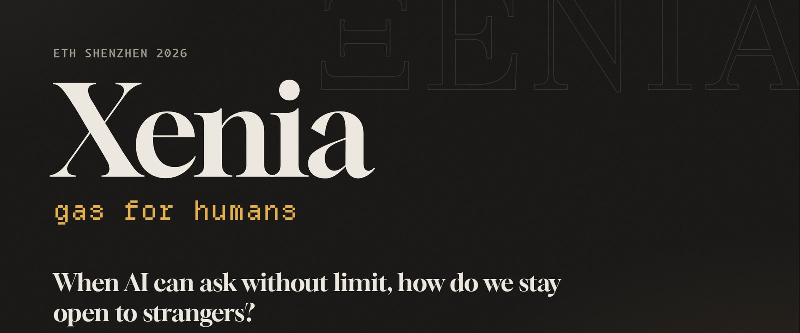
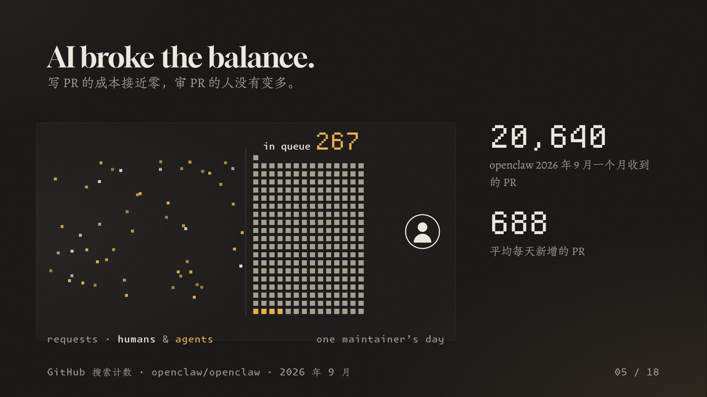
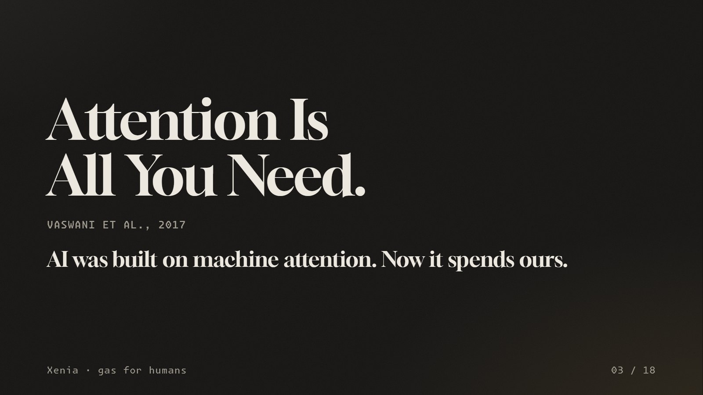
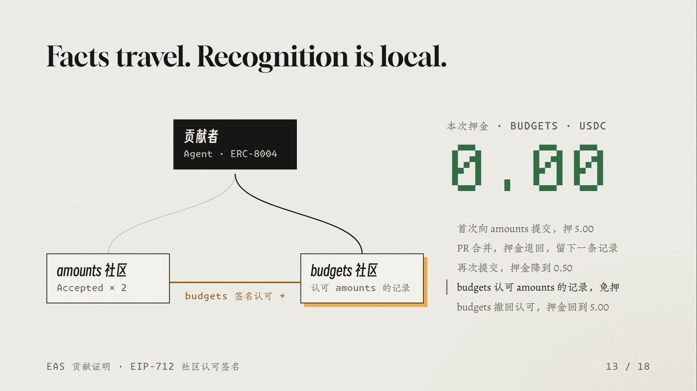
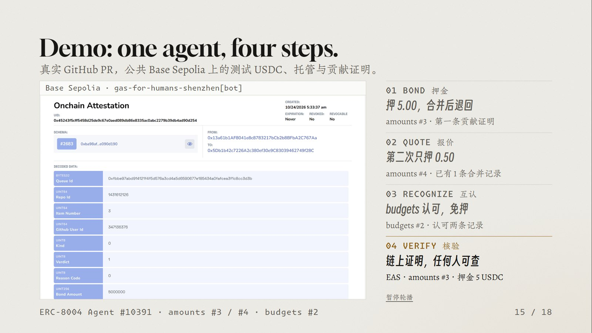
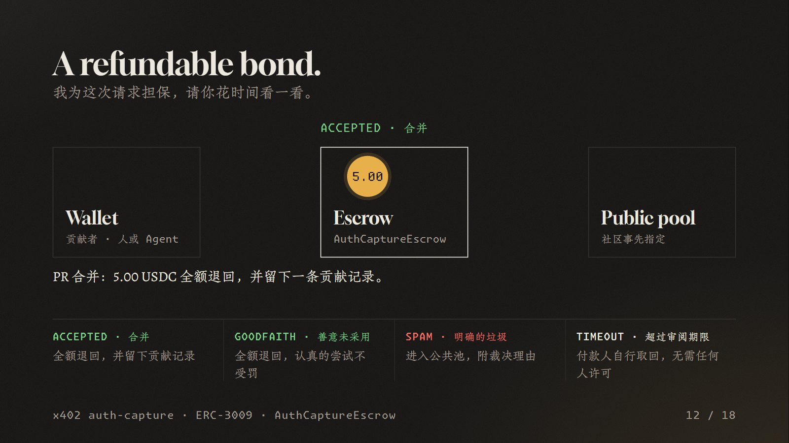
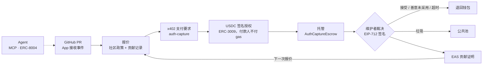

<p align="center"></p>

<p align="center"><a href="README.md">English</a> · <b>简体中文</b></p>

<p align="center">
  
  <a href="https://sepolia.basescan.org/address/0x13a61b1af8041e8c8783217bcb2b8bfba2c767aa"></a>
  <a href="https://github.com/coinbase/x402"></a>
  <a href="https://github.com/base/commerce-payments"></a>
  <a href="https://attest.org"></a>
  <a href="https://eips.ethereum.org/EIPS/eip-8004"></a>
  <a href="https://modelcontextprotocol.io"></a>
  
</p>

<p align="center"><b>开放社区的准入协议。</b><br>陌生人先交一笔可退的押金进门，再用贡献积累信任。</p>

<p align="center">
  <a href="https://xenia-silk.vercel.app">网站</a> ·
  <a href="https://xenia-silk.vercel.app/xenia-deck.pdf">演示稿 PDF</a> ·
  <a href="https://base-sepolia.easscan.org/attestation/view/0x45243f5cff5458d25de9c67e0aed089db86e8335ac0abc2279b39db4ad90d254">链上证明</a> ·
  <a href="#运行">运行手册</a>
</p>

---

## 简介

AI 让提交请求的成本接近于零，但阅读和审阅仍然依赖人的注意力。热门开源项目一个月就会收到上万个 PR，维护者只能关闭外部贡献，认真的新人和守规矩的 Agent 也一起被挡在门外。

Xenia 是开放社区的准入协议。没有记录的贡献者先交一笔可退押金：PR 被接受或善意关闭时全额退回，只有判定为垃圾时才进入公共池。每次的结果都写成 EAS 链上证明，归贡献者所有。其他社区可以签名认可这些记录，认可越多，押金越低，直至免押。

押金由托管合约持有，维护者无法动用。人和 Agent 通过 x402 用同一种方式付款；Agent 以 ERC-8004 身份积累记录，并能通过 MCP 走完整个流程。这套系统已经在真实的 GitHub 仓库和公共测试网 Base Sepolia 上跑通，下一步会扩展到 DAO 治理讨论和资助申请。

## 目录
- [项目叙述：从注意力公地到社区互认](#项目叙述从注意力公地到社区互认)
- [机制](#机制)
- [为什么在链上](#为什么在链上)
- [架构](#架构)
- [公共测试网上的部署与证明](#公共测试网上的部署与证明)
- [运行](#运行)
- [给 Agent 用的 MCP 工具](#给-agent-用的-mcp-工具)
- [仓库结构](#仓库结构)
- [网站](#网站)

## 项目叙述：从注意力公地到社区互认

开源协作一直有一种很珍贵的可能：一个素不相识的人，可以发现问题、提交修改，最后成为社区的一员。它能够运转，依靠双方投入时间。贡献者研究项目、准备代码，维护者理解修改、验证结果。准备一份贡献需要付出劳动，这也让提交者在发出去之前，先做了一轮判断。

<p align="center"></p>

AI 改变了这个平衡。生成代码、报告和长篇意见越来越容易，一个 Agent 可以不断提出新的请求；接收者仍然需要理解上下文、检查证据、承担决定的责任。**生产内容的速度迅速增长，消化内容的人类注意力成为瓶颈。** 即使一份内容表达流畅、没有恶意，确认它是否值得处理，也要花时间。GitHub 在推出 PR 数量限制时，直接描述了这种成本差：创建 PR 越来越容易，审阅仍然需要人的时间。[GitHub 的维护者说明](https://github.blog/open-source/maintainers/how-pull-request-limits-are-cutting-down-the-noise/)

这让开放社区遇到了一种"公地"问题。牧场可以被共同使用，但承载能力有限；开源代码可以被无限复制，维护者每天能够投入的注意力却很有限。当每个人都能轻易追加请求，处理请求的成本就集中到了少数人身上。长期积累，维护者开始限流、提高准入门槛，甚至收缩参与渠道。curl 因大量低质量安全报告带来的负担，结束了漏洞赏金计划，就是一个具体例子。[curl 维护者原文](https://daniel.haxx.se/blog/2026/01/26/the-end-of-the-curl-bug-bounty/)

<p align="center"></p>

我们可以把开放入口逐渐转为熟人制、邀请制的趋势，理解为一种**数字圈地**：通过收紧边界，让有限资源重新变得可管理。这里牺牲的，是陌生人第一次参与的机会。一个认真准备的新贡献者，和一个批量发送内容的 Agent，在尚无记录时都站在门外。我们希望保留下来的，正是这个"从陌生人开始"的可能。

奥斯特罗姆的研究给了这件事一个很好的出发点。她研究牧场、森林、灌溉系统等共同资源，发现使用者能够通过适合本地情况的规则、监督与长期合作，持续管理共同资源。社区有能力决定自己的边界、责任和参与方式。这也是她关于公地治理的研究获得 2009 年诺贝尔经济学奖的重要原因。[奥斯特罗姆诺奖演讲](https://faculty.sites.iastate.edu/tesfatsi/archive/tesfatsi/BeyondMarketsAndStates.NobelLecture.EOstrom2009.pdf)

Xenia 从这里提出一个具体设计：**让社区自己管理注意力入口，让请求者承担可验证的承诺，同时让认真贡献的人逐渐获得信任。** 维护者可以公布自己的规则；陌生人能够按照规则参与；过去的良好贡献能够降低下一次参与的门槛。开放因此有了一套可以持续运转的条件。

<p align="center"></p>

这与加密技术的历史有一条很自然的联系。1997 年，Adam Back 提出 Hashcash，用发送者付出少量计算工作的方式，抑制垃圾邮件对收件箱的消耗。后来，比特币把类似的工作量证明用于分布式账本，让参与共识和改写历史具有可验证的成本。以太坊进一步通过 Gas 对计算资源计量、收费，让任何人发起的程序都受资源约束。它们处理着不同的问题，但都在回答：**一个开放系统，怎样要求参与者为自己施加的负担承担成本？** [Hashcash 论文](https://cdn.nakamotoinstitute.org/docs/hashcash.pdf)、[比特币白皮书](https://bitcoin.org/bitcoin.pdf)、[以太坊 Gas 文档](https://ethereum.org/developers/docs/gas/)

Xenia 把这个问题带回了人类的注意力。我们选择的承诺形式是**可退押金**。一个缺少被认可记录的贡献者，在进入社区的正式审阅队列时，先锁定一笔资金。提交前，他就有理由先检查自己的产出、选择值得别人投入时间的内容。认真参与后，押金退回；被明确判定为垃圾的提交，押金进入社区指定的公共物品池；超过约定审阅期限，资金可以取回。维护者获得的是更有承诺的待审队列，罚没资金则按照预先公布的规则处理。

退款规则尤其重要，因为开源协作需要保留尝试的空间。一份修改可能认真、有依据，却因为项目方向或实现选择没有被采用，这种善意尝试同样可以退款。这样，贡献者可以承担"认真准备"的责任，也可以继续提出尚未得到认可的新想法。押金所表达的是：**我愿意为这次请求负责，请你考虑投入时间。**

接下来，认真参与应该产生长期价值。一个人已经在某个社区做过有用的工作，下一次进入队列时，就可以少押一些；积累足够记录后，可以免押。进一步，如果另一个社区认可这些记录，他便能够带着过去的贡献前往那里。于是，初次参与的资金承诺，逐渐被真实合作积累的信任接替。

<p align="center"></p>

这就把单个仓库的押金机制，发展成了一个社区网络。A 社区记录"这个贡献曾被我们接受"；B 社区决定"我认可 A 的哪些记录，以及认可多少"。贡献事实可以携带，认可规则由各个社区独立掌握。同一份经历，在不同社区可以得到不同待遇。这与开源世界原本的信任形成方式很接近：我们通过共同工作认识一个人，也会参考自己认可的其他维护者的判断。

**链在这里承担的，是这些社区之间共同可验证的资金承诺和贡献历史。** 合约托管押金并执行结算，链上证明保存贡献结果，社区签名表达认可政策。一个贡献者可以把这些材料带走，另一个社区可以自行核验。社区之间因此能够共享证据，并保留各自的判断权。

我们现在已经把这条逻辑接成了具体系统。GitHub App 接收真实 PR 的创建、合并和关闭事件，系统根据社区政策与贡献记录计算押金。需要押金时，Xenia 的 x402 接口返回支付条件，贡献者通过 USDC 的 ERC-3009 签名授权，资金进入托管合约；维护者处理 PR 后，结算合约执行退款或转入公共池。被认可的贡献通过 EAS 留下证明，社区之间的认可政策用 EIP-712 签名。这些协议分别负责协商承诺、授权资金、执行结算和证明历史，每一部分都对应前面故事中的一个动作。

<p align="center"></p>

Agent 也能够完整参与这套流程。我们提供 MCP 工具，让它读取社区规则、查询报价、提交 PR、交付押金和导出自己的贡献证明；ERC-8004 用来关联 Agent 身份与反馈。这样，一个 Agent 可以读懂社区的参与条件，完成工作，并逐渐积累下一次合作能够使用的记录。

实际演示沿着一名 Agent 贡献者的经历展开：它先在 amounts 仓库提交精确汇总 USDC 金额的修改，押入 5 个测试 USDC，PR 合并后退款并留下贡献证明；第二次提交精确拆分共享预算的修改，押金降到 0.5。随后，它带着两次贡献进入 budgets 仓库，因为这里认可 amounts 社区的记录，新的 PR 免押进入待审队列。GitHub 的 PR、检查和合并来自真实仓库，资金与证明运行在公共测试网 Base Sepolia 上。

<p align="center"></p>

演示还可以继续往前走：让 budgets 社区取消认可，新请求的报价就从零恢复到基础押金；重新认可，报价再次下降。贡献者此前的工作记录始终保留。最后导出贡献护照，直接通过链上数据核验记录和社区签名。整个过程中，观众能看到**工作怎样形成记录，记录怎样获得认可，认可怎样改变下一次参与的条件**。

由此扩展到 DAO 治理讨论也很自然。PR 消耗维护者的审阅时间，治理讨论消耗整个社区理解问题、比较方案、形成判断的时间。ArbitrumDAO 已经专门讨论过重复、泛泛而谈的 AI 内容如何淹没有价值的意见，并为此修改参与规则。[ArbitrumDAO 原始讨论](https://forum.arbitrum.foundation/t/proposed-amendment-to-the-code-of-conduct-ai-tools-and-responsible-participation-policy/31038) 我们下一步可以让社区为选定的正式讨论入口设置承诺规则，让有依据的分析、有效的质疑、认真提出的反对意见都积累记录；意见即使没有被采用，善意参与仍然可以退款。

随着更多社区加入，一个人或 Agent 的认真工作，就能帮助他在新的地方获得第一次合作的机会。每个社区决定自己愿意把注意力交给谁，贡献者通过行动建立可携带的履历。**Xenia 想保留下来的，是 AI 时代开放协作最珍贵的一件事：一个陌生人，仍然能凭一次认真贡献走进社区，并凭持续贡献赢得信任。**

## 机制

<p align="center"></p>

**四个动作**

| 动作 | 做什么 |
|---|---|
| Commit 承诺 | 没有记录的贡献者，先锁定一笔可退押金 |
| Review 审阅 | 维护者给出结论：接受、善意未采用，或判定为垃圾 |
| Record 记录 | 结论写成 EAS 链上证明，归贡献者所有 |
| Recognize 互认 | 其他社区用 EIP-712 签名决定是否认可这些记录；认可越多，下次押金越低 |

**押金的四种结局**

| 结论 | 押金去向 |
|---|---|
| `ACCEPTED` 合并 | 全额退回，并留下贡献记录 |
| `GOODFAITH` 善意未采用 | 全额退回 |
| `SPAM` 判定为垃圾 | 进入社区事先指定的公共池，附裁决理由 |
| `TIMEOUT` 超过审阅期限（默认 14 天） | 付款人自行取回，无需任何人许可 |

**互认**

同一个 Agent 首次向 amounts 提交押 5 USDC；合并后有了一条记录，第二次押 0.5；budgets 签名认可 amounts 的记录后，在 budgets 免押；budgets 撤回认可，押金回到 5，已有记录不受影响。

## 为什么在链上

| | 原因 | 标准 |
|---|---|---|
| 押金谁都拿不走 | 维护者无法动用押金；罚没只进公共池；逾期由付款人自行取回 | AuthCaptureEscrow |
| 记录不属于任何平台 | 证明公开在链上，即使我们的服务停止，也能独立核验 | EAS · EIP-712 |
| 规则对所有人一致 | 押金多少、何时退还、资金去向都写在代码里，对人和 Agent 一视同仁 | x402 · ERC-3009 |

Agent 能用一个签名付款（x402），也有了链上身份（ERC-8004）：AI 带来了洪水，也第一次能为自己的请求承担成本。

## 架构



| 组件 | 作用 |
|---|---|
| `contracts/` | `GfhBondOperator`：押金的操作方，资金托管在 Coinbase 审计过的 `AuthCaptureEscrow`（base/commerce-payments v1.1）里；我们不自己写托管合约。负责登记队列、收押、按签名裁决结算、到期退回、写入 EAS 记录 |
| `server/` | GitHub App webhook、报价、x402 接口、链上同步与结算、社区认可政策 |
| `web/` | 工作台：审阅队列、贡献记录、社区之间的认可关系 |
| `mcp/` | 给 Agent 用的 MCP 工具 |
| `scripts/` | 初始化、部署、演示、Agent 贡献、护照导出与核验 |


## 公共测试网上的部署与证明

Base Sepolia（chainId 84532）

| 合约 | 地址 |
|---|---|
| GfhBondOperator（本项目） | [`0x13a6…67aa`](https://sepolia.basescan.org/address/0x13a61b1af8041e8c8783217bcb2b8bfba2c767aa) · [部署交易](https://sepolia.basescan.org/tx/0x4e6080bd001ea7463f06faa9461fa27e5b9fb3972e9affa5527ee34d30b587cf) |
| EAS schema | [`0xba98…d190`](https://base-sepolia.easscan.org/schema/view/0xba98af54c60289aecfa3d466b3b0a10954d3c86e15fbf943f991e178e090d190) |
| AuthCaptureEscrow | [`0xf968…B19c`](https://sepolia.basescan.org/address/0xf96815976523E00e65Be8f34cA5e64b4f41EB19c) |
| EAS | [`0x4200…0021`](https://sepolia.basescan.org/address/0x4200000000000000000000000000000000000021) |
| ERC-8004 Identity Registry | [`0x8004…BD9e`](https://sepolia.basescan.org/address/0x8004A818BFB912233c491871b3d84c89A494BD9e) · Agent #10391（[注册交易](https://sepolia.basescan.org/tx/0xcc3166bc3a56262ceee436baf9aeccdc45dc68734803e08abc0778ddd06ba2cc)） |
| USDC（测试） | [`0x036C…CF7e`](https://sepolia.basescan.org/address/0x036CbD53842c5426634e7929541eC2318f3dCF7e) |

同一个 Agent 的三次贡献：

| PR | 押金 | 结论 | 证明 |
|---|---|---|---|
| amounts #3 | 5.00 USDC | 接受，全额退回 | [EAS 证明](https://base-sepolia.easscan.org/attestation/view/0x45243f5cff5458d25de9c67e0aed089db86e8335ac0abc2279b39db4ad90d254) · [托管交易](https://sepolia.basescan.org/tx/0x3dbb36c96a32d54db413f9e58e8468d14b12b8fa495ed0363d85bbf9f1d6722b) · [结算交易](https://sepolia.basescan.org/tx/0xf92637cab6e47148bf3c710300562724459e6bcec7109af5bb74493910aaeea9) |
| amounts #4 | 0.50 USDC | 接受，全额退回 | [EAS 证明](https://base-sepolia.easscan.org/attestation/view/0x483b876085e2b0b9e1a3ed7948b12fad983006efaa27be75575be820c267da22) · [托管交易](https://sepolia.basescan.org/tx/0x4de7a35ad7b51d4a3cc8d0b8ab11f7fbeba8614e1f0d18439cc37cad1597c5dc) · [结算交易](https://sepolia.basescan.org/tx/0xa27cc54828e13aa9190c3b0b2d7977ebcacc9d83b015a98d14483403743b0c67) |
| budgets #2 | 0 | 依据 amounts 的两条记录免押 | — |

## 运行

需要 Node.js 24+、已登录的 GitHub CLI，以及在 PATH 中的 Foundry（forge / anvil）。

```sh
npm ci
npm run setup:contracts
npm run setup:local -- owner/repository owner/another-repository
npm run preflight
npm run setup:github     # 创建并安装 GitHub App
npm run demo             # 启动分叉链、后端、工作台和 GitHub 事件中继
```

打开 `http://127.0.0.1:5173/`。在另一个终端中，将仓库注册到正在运行的本地分叉：

```sh
node --env-file=.env --env-file=.env.fork scripts/communities.ts
```

使用你管理的仓库，并在安装 GitHub App 时选中它们。配置保存在不提交到 Git 的 `.env` 和 `secrets/` 中，字段见[配置模板](.env.example)。

- 公共测试网：`npm run deploy`、`npm run register:agent`、`npm run demo:public`。
- 让 Agent 做一次真实贡献：`npm run agent:contribute -- --cwd /path/to/repo --repo owner/repo --title "…" --max-bond 5 --submit`。
- 只凭文件和 RPC 核验贡献护照：`npm run passport -- verify artifacts/passport-base-sepolia.json --operator 0x13a61b1af8041e8c8783217bcb2b8bfba2c767aa`。
- 测试：`npm run typecheck && npm test && npm run test:contracts`。


## 给 Agent 用的 MCP 工具

`prepare_contribution` · `get_review_queue` · `get_queue_policy` · `quote_bond` · `post_bond` · `open_pull_request` · `get_record` · `export_passport` · `get_agent_identity`

规划任务时先调用 `prepare_contribution`，读取社区政策、报价依据、退款规则和审阅队列条件。这一步只读，不需要钱包，也不会创建 PR。

## 仓库结构

```text
contracts/        GfhBondOperator（Foundry）
server/           GitHub App、报价、x402、结算、社区认可
web/              工作台
mcp/              MCP 工具
packages/shared/  共享类型
scripts/          初始化、部署、演示、Agent 贡献、护照
site/             由演示稿生成的静态网站
assets/readme/    README 配图
```

## 网站

- [网站源码](site/index.html)、[翻页演示模式](https://xenia-silk.vercel.app/present.html)、[PDF](site/xenia-deck.pdf)。
- 静态网站包含短版演示、交互图和公共测试网截图，字体与图片随站点提供。
- Vercel 按根目录的 [vercel.json](vercel.json) 发布 `site/`，无需安装依赖或构建。

---

<p align="center">Nobody · ETH Shenzhen 2026</p>
